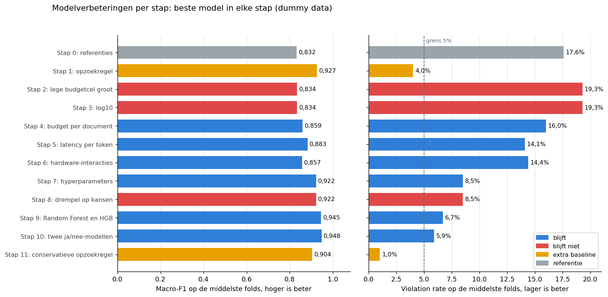

# Modelverbeteringen

**LET OP: dit is DUMMY data, de scores zeggen niets over echte modellen.**

**Herhaalde run (23-11-2026).** Het notebook is opnieuw gedraaid op de herziene split (8 inputlengtes, 2 testlengtes die niemand kent) en met drie categorieën (compact, medium en groot). Het overzicht, de figuur, de eindtabel en de conclusie komen uit deze run. De tabellen en besluiten per stap hieronder komen nog uit de eerste run (oude split met testlengte 256, twee categorieën). In de nieuwe run staan geen tabellen per foldlengte meer, omdat je daaruit met 8 lengtes de testlengtes kunt afleiden.

## Inleiding

Doel: de trainbare modellen stap voor stap verbeteren, van simpel naar ingewikkeld, en elke stap vastleggen. Alles staat in `notebooks/04_modelverbeteringen.ipynb`, en alle tabellen hieronder komen uit de uitgevoerde output van dat notebook. Ik evalueer alleen op de 5 CV-folds uit het splitmanifest. De testfamilies blijven dicht. Elke feature-bewerking en de schaling zitten in een sklearn-pipeline, zodat ze per fold alleen op de trainfolds geleerd worden.

**Beslisregel.** Een stap blijft als de macro-F1 op de middelste folds (128, 192, 384) meer dan 0,005 stijgt en de violation rate daar niet meer dan 1 procentpunt stijgt. Een stap blijft ook als de macro-F1 ongeveer gelijk is (hoogstens 0,005 verschil) en de violation rate daalt. Deze twee marges heb ik vastgelegd voordat er resultaten waren. Een stap kan per model anders uitvallen. Blijft hij niet, dan gaat dat model verder met zijn oude stand.

**Maten.** Dezelfde maten en definities als in `01_baseline.ipynb`: macro-F1, confusion matrix, violations, violation rate, gemiste kansen en gemiste-kansrate. De confusion matrix is steeds over alle folds samen.

## Stap 0: referenties

**Wat is veranderd.** Niets. Baseline, logistische regressie en beslisboom zijn opnieuw berekend met dezelfde instellingen als de bestaande notebooks.

**Waarom.** Zo is er één vergelijkingspunt in één notebook. De totaalscores zijn gelijk aan die in `01_baseline.ipynb`, `02_logistic_regression.ipynb` en `03_decision_tree.ipynb`.

| Model | Deel | Macro-F1 | Violations | Violation rate | Gemiste kansen | Gemiste-kansrate |
|---|---|---|---|---|---|---|
| Baseline | Totaal | 0,774 | 172 van 1014 | 17,0% | 191 van 1035 | 18,5% |
| Baseline | Midden (128, 192, 384) | 0,805 | 99 van 613 | 16,2% | 93 van 609 | 15,3% |
| Baseline | Rand 64 | 0,716 | 5 van 203 | 2,5% | 81 van 279 | 29,0% |
| Baseline | Rand 512 | 0,727 | 68 van 198 | 34,3% | 17 van 147 | 11,6% |
| Logistische regressie | Totaal | 0,763 | 188 van 1011 | 18,6% | 201 van 1035 | 19,4% |
| Logistische regressie | Midden (128, 192, 384) | 0,761 | 134 van 629 | 21,3% | 103 van 609 | 16,9% |
| Logistische regressie | Rand 64 | 0,740 | 28 van 263 | 10,6% | 44 van 279 | 15,8% |
| Logistische regressie | Rand 512 | 0,716 | 26 van 119 | 21,8% | 54 van 147 | 36,7% |
| Beslisboom | Totaal | 0,795 | 193 van 1076 | 17,9% | 144 van 1035 | 13,9% |
| Beslisboom | Midden (128, 192, 384) | 0,832 | 118 van 669 | 17,6% | 50 van 609 | 8,2% |
| Beslisboom | Rand 64 | 0,756 | 8 van 220 | 3,6% | 67 van 279 | 24,0% |
| Beslisboom | Rand 512 | 0,700 | 67 van 187 | 35,8% | 27 van 147 | 18,4% |

Beste op de middelste folds: Beslisboom.

| Echt \ voorspeld | compact | medium | geen |
|---|---|---|---|
| compact | 468 | 10 | 43 |
| medium | 8 | 405 | 101 |
| geen | 90 | 95 | 452 |

**Besluit.** Referentie.

## Stap 1: opzoekregel

**Wat is veranderd.** Een extra baseline: de labelregel, toegepast op de dichtstbijzijnde gemeten inputlengte uit de trainfolds. Bij gelijke afstand telt de langere lengte, want die is strenger. Alleen configuraties uit de trainfolds tellen mee.

**Waarom.** Dit is wat je zonder ML al kunt doen. ML moet dit verslaan om de moeite waard te zijn.

| Inputlengte in de fold | Opgezochte lengte |
|---|---|
| 64 | 128 |
| 128 | 192 |
| 192 | 128 |
| 384 | 512 |
| 512 | 384 |

| Model | Deel | Macro-F1 | Violations | Violation rate | Gemiste kansen | Gemiste-kansrate |
|---|---|---|---|---|---|---|
| Opzoekregel | Totaal | 0,921 | 33 van 977 | 3,4% | 87 van 1035 | 8,4% |
| Opzoekregel | Midden (128, 192, 384) | 0,927 | 23 van 581 | 4,0% | 47 van 609 | 7,7% |
| Opzoekregel | Rand 64 | 0,869 | 0 van 243 | 0,0% | 36 van 279 | 12,9% |
| Opzoekregel | Rand 512 | 0,943 | 10 van 153 | 6,5% | 4 van 147 | 2,7% |
| Baseline | Totaal | 0,774 | 172 van 1014 | 17,0% | 191 van 1035 | 18,5% |
| Baseline | Midden (128, 192, 384) | 0,805 | 99 van 613 | 16,2% | 93 van 609 | 15,3% |
| Baseline | Rand 64 | 0,716 | 5 van 203 | 2,5% | 81 van 279 | 29,0% |
| Baseline | Rand 512 | 0,727 | 68 van 198 | 34,3% | 17 van 147 | 11,6% |

| Echt \ voorspeld | compact | medium | geen |
|---|---|---|---|
| compact | 471 | 13 | 37 |
| medium | 4 | 460 | 50 |
| geen | 12 | 17 | 608 |

**Besluit.** Blijft als extra baseline om mee te vergelijken. De trainbare modellen hieronder bouwen er niet op voort.

## Stap 2: lege budgetcel wordt een groot getal

**Wat is veranderd.** Een lege budgetcel wordt 1e12 in plaats van 0, met `has_energy_budget` erbij. Voor logistische regressie en beslisboom.

**Waarom.** Een budget van 0 betekent ook "strengst mogelijk", terwijl geen budget juist "geen eis" betekent.

| Model | Deel | Macro-F1 | Violations | Violation rate | Gemiste kansen | Gemiste-kansrate |
|---|---|---|---|---|---|---|
| Logistische regressie | Totaal | 0,762 | 187 van 1007 | 18,6% | 204 van 1035 | 19,7% |
| Logistische regressie | Midden (128, 192, 384) | 0,762 | 133 van 627 | 21,2% | 104 van 609 | 17,1% |
| Logistische regressie | Rand 64 | 0,741 | 27 van 262 | 10,3% | 44 van 279 | 15,8% |
| Logistische regressie | Rand 512 | 0,705 | 27 van 118 | 22,9% | 56 van 147 | 38,1% |
| Beslisboom | Totaal | 0,803 | 216 van 1139 | 19,0% | 107 van 1035 | 10,3% |
| Beslisboom | Midden (128, 192, 384) | 0,834 | 138 van 716 | 19,3% | 26 van 609 | 4,3% |
| Beslisboom | Rand 64 | 0,755 | 3 van 207 | 1,4% | 75 van 279 | 26,9% |
| Beslisboom | Rand 512 | 0,751 | 75 van 216 | 34,7% | 6 van 147 | 4,1% |

Beste op de middelste folds: Beslisboom.

| Echt \ voorspeld | compact | medium | geen |
|---|---|---|---|
| compact | 471 | 9 | 41 |
| medium | 5 | 443 | 66 |
| geen | 91 | 120 | 426 |

**Besluit.**

- Logistische regressie: **blijft**. Middelste folds: macro-F1 0,761 naar 0,762, violation rate 21,3% naar 21,2%.
- Beslisboom: **blijft niet**. Middelste folds: macro-F1 0,832 naar 0,834, violation rate 17,6% naar 19,3%.

## Stap 3: log10

**Wat is veranderd.** `max_latency_ms_per_doc`, `monthly_volume` en `max_energy_kwh_per_month` worden vervangen door hun log10. Dit kan alleen met het grote getal uit stap 2, want de log10 van 0 bestaat niet. Daarom hoort dat getal bij deze stap, ook voor de beslisboom, waar stap 2 niet bleef.

**Waarom.** Deze waarden lopen over meerdere ordes van grootte. Dat past slecht bij een lineair model.

| Model | Deel | Macro-F1 | Violations | Violation rate | Gemiste kansen | Gemiste-kansrate |
|---|---|---|---|---|---|---|
| Logistische regressie | Totaal | 0,794 | 162 van 1014 | 16,0% | 171 van 1035 | 16,5% |
| Logistische regressie | Midden (128, 192, 384) | 0,810 | 118 van 645 | 18,3% | 70 van 609 | 11,5% |
| Logistische regressie | Rand 64 | 0,752 | 23 van 257 | 8,9% | 45 van 279 | 16,1% |
| Logistische regressie | Rand 512 | 0,715 | 21 van 112 | 18,8% | 56 van 147 | 38,1% |
| Beslisboom | Totaal | 0,803 | 216 van 1139 | 19,0% | 107 van 1035 | 10,3% |
| Beslisboom | Midden (128, 192, 384) | 0,834 | 138 van 716 | 19,3% | 26 van 609 | 4,3% |
| Beslisboom | Rand 64 | 0,755 | 3 van 207 | 1,4% | 75 van 279 | 26,9% |
| Beslisboom | Rand 512 | 0,751 | 75 van 216 | 34,7% | 6 van 147 | 4,1% |

Beste op de middelste folds: Beslisboom.

| Echt \ voorspeld | compact | medium | geen |
|---|---|---|---|
| compact | 471 | 9 | 41 |
| medium | 5 | 443 | 66 |
| geen | 91 | 120 | 426 |

**Besluit.** De scores van de beslisboom zijn gelijk aan stap 2: de log10 zelf verandert voor de boom niets.

- Logistische regressie: **blijft**. Middelste folds: macro-F1 0,762 naar 0,810, violation rate 21,2% naar 18,3%.
- Beslisboom: **blijft niet**. Middelste folds: macro-F1 0,832 naar 0,834, violation rate 17,6% naar 19,3%.

## Stap 4: budget per document

**Wat is veranderd.** Twee kolommen erbij: `budget_j_per_doc` (`max_energy_kwh_per_month` × 3.600.000 / `monthly_volume`) en de log10 daarvan. Bij geen budget is `budget_j_per_doc` een groot getal.

**Waarom.** Een budget per maand zegt alleen iets samen met het volume, en die verhouding vindt een model niet makkelijk zelf.

| Model | Deel | Macro-F1 | Violations | Violation rate | Gemiste kansen | Gemiste-kansrate |
|---|---|---|---|---|---|---|
| Logistische regressie | Totaal | 0,809 | 147 van 1010 | 14,6% | 160 van 1035 | 15,5% |
| Logistische regressie | Midden (128, 192, 384) | 0,831 | 108 van 646 | 16,7% | 59 van 609 | 9,7% |
| Logistische regressie | Rand 64 | 0,768 | 21 van 258 | 8,1% | 42 van 279 | 15,1% |
| Logistische regressie | Rand 512 | 0,710 | 18 van 106 | 17,0% | 59 van 147 | 40,1% |
| Beslisboom | Totaal | 0,838 | 165 van 1093 | 15,1% | 101 van 1035 | 9,8% |
| Beslisboom | Midden (128, 192, 384) | 0,859 | 109 van 680 | 16,0% | 32 van 609 | 5,3% |
| Beslisboom | Rand 64 | 0,792 | 1 van 217 | 0,5% | 63 van 279 | 22,6% |
| Beslisboom | Rand 512 | 0,807 | 55 van 196 | 28,1% | 6 van 147 | 4,1% |

Beste op de middelste folds: Beslisboom.

| Echt \ voorspeld | compact | medium | geen |
|---|---|---|---|
| compact | 480 | 9 | 32 |
| medium | 6 | 439 | 69 |
| geen | 65 | 94 | 478 |

**Besluit.**

- Logistische regressie: **blijft**. Middelste folds: macro-F1 0,810 naar 0,831, violation rate 18,3% naar 16,7%.
- Beslisboom: **blijft**. Middelste folds: macro-F1 0,832 naar 0,859, violation rate 17,6% naar 16,0%.

## Stap 5: latency per token

**Wat is veranderd.** Twee kolommen erbij: `max_latency_ms_per_doc` / `input_length_tokens` en de log10 daarvan.

**Waarom.** Of een latency-eis haalbaar is, hangt af van de lengte van de input. De verhouding zegt dat direct.

| Model | Deel | Macro-F1 | Violations | Violation rate | Gemiste kansen | Gemiste-kansrate |
|---|---|---|---|---|---|---|
| Logistische regressie | Totaal | 0,816 | 139 van 1003 | 13,9% | 162 van 1035 | 15,7% |
| Logistische regressie | Midden (128, 192, 384) | 0,829 | 95 van 621 | 15,3% | 74 van 609 | 12,2% |
| Logistische regressie | Rand 64 | 0,743 | 22 van 250 | 8,8% | 51 van 279 | 18,3% |
| Logistische regressie | Rand 512 | 0,806 | 22 van 132 | 16,7% | 37 van 147 | 25,2% |
| Beslisboom | Totaal | 0,884 | 132 van 1102 | 12,0% | 56 van 1035 | 5,4% |
| Beslisboom | Midden (128, 192, 384) | 0,883 | 95 van 672 | 14,1% | 23 van 609 | 3,8% |
| Beslisboom | Rand 64 | 0,869 | 9 van 262 | 3,4% | 26 van 279 | 9,3% |
| Beslisboom | Rand 512 | 0,880 | 28 van 168 | 16,7% | 7 van 147 | 4,8% |

Beste op de middelste folds: Beslisboom.

| Echt \ voorspeld | compact | medium | geen |
|---|---|---|---|
| compact | 486 | 9 | 26 |
| medium | 9 | 475 | 30 |
| geen | 33 | 90 | 514 |

**Besluit.**

- Logistische regressie: **blijft**. Middelste folds: macro-F1 0,831 naar 0,829, violation rate 16,7% naar 15,3%.
- Beslisboom: **blijft**. Middelste folds: macro-F1 0,859 naar 0,883, violation rate 16,0% naar 14,1%.

## Stap 6: hardware-interacties

**Wat is veranderd.** De numerieke (log-)features worden ook vermenigvuldigd met een CPU-indicator. Alleen voor de logistische regressie.

**Waarom.** Een lineair model heeft anders voor GPU en CPU dezelfde hellingen, terwijl de CPU veel trager is. Een beslisboom kan dat zelf al splitsen.

| Model | Deel | Macro-F1 | Violations | Violation rate | Gemiste kansen | Gemiste-kansrate |
|---|---|---|---|---|---|---|
| Logistische regressie | Totaal | 0,838 | 130 van 1026 | 12,7% | 133 van 1035 | 12,9% |
| Logistische regressie | Midden (128, 192, 384) | 0,857 | 93 van 647 | 14,4% | 49 van 609 | 8,0% |
| Logistische regressie | Rand 64 | 0,757 | 21 van 251 | 8,4% | 49 van 279 | 17,6% |
| Logistische regressie | Rand 512 | 0,818 | 16 van 128 | 12,5% | 35 van 147 | 23,8% |

Beste op de middelste folds: Logistische regressie.

| Echt \ voorspeld | compact | medium | geen |
|---|---|---|---|
| compact | 457 | 12 | 52 |
| medium | 6 | 427 | 81 |
| geen | 50 | 74 | 513 |

**Besluit.**

- Logistische regressie: **blijft**. Middelste folds: macro-F1 0,829 naar 0,857, violation rate 15,3% naar 14,4%.

## Stap 7: hyperparameters

**Wat is veranderd.** Beslisboom: `max_depth` 3 tot en met 10 en `min_samples_leaf` 1, 5 of 20. Logistische regressie: `C` 0,01, 0,1, 1, 10 of 100. Ik kies uit de instellingen die door de beslisregel komen die met de hoogste macro-F1 op de middelste folds.

**Waarom.** Tot nu toe stonden de instellingen vast. Let op: kiezen op dezelfde folds als waarop ik de score meet, is iets optimistisch.

Logistische regressie, alle instellingen:

| Instellingen | Macro-F1 midden | Violation rate midden | Gemiste-kansrate midden |
|---|---|---|---|
| C=10 | 0,872 | 11,8% | 8,2% |
| C=100 | 0,865 | 11,6% | 9,0% |
| C=1 | 0,857 | 14,4% | 8,0% |
| C=0.1 | 0,835 | 16,9% | 9,0% |
| C=0.01 | 0,823 | 17,3% | 11,0% |

Beslisboom, de beste 5 van 24:

| Instellingen | Macro-F1 midden | Violation rate midden | Gemiste-kansrate midden |
|---|---|---|---|
| max_depth=10, min_samples_leaf=1 | 0,922 | 8,5% | 3,6% |
| max_depth=8, min_samples_leaf=1 | 0,922 | 9,3% | 2,8% |
| max_depth=9, min_samples_leaf=1 | 0,921 | 8,7% | 3,6% |
| max_depth=7, min_samples_leaf=1 | 0,920 | 9,4% | 3,0% |
| max_depth=7, min_samples_leaf=5 | 0,912 | 10,6% | 3,1% |

| Model | Deel | Macro-F1 | Violations | Violation rate | Gemiste kansen | Gemiste-kansrate |
|---|---|---|---|---|---|---|
| Logistische regressie | Totaal | 0,852 | 118 van 1027 | 11,5% | 116 van 1035 | 11,2% |
| Logistische regressie | Midden (128, 192, 384) | 0,872 | 74 van 626 | 11,8% | 50 van 609 | 8,2% |
| Logistische regressie | Rand 64 | 0,759 | 27 van 262 | 10,3% | 41 van 279 | 14,7% |
| Logistische regressie | Rand 512 | 0,841 | 17 van 139 | 12,2% | 25 van 147 | 17,0% |
| Beslisboom | Totaal | 0,908 | 79 van 1042 | 7,6% | 64 van 1035 | 6,2% |
| Beslisboom | Midden (128, 192, 384) | 0,922 | 54 van 634 | 8,5% | 22 van 609 | 3,6% |
| Beslisboom | Rand 64 | 0,852 | 9 van 256 | 3,5% | 31 van 279 | 11,1% |
| Beslisboom | Rand 512 | 0,901 | 16 van 152 | 10,5% | 11 van 147 | 7,5% |

Beste op de middelste folds: Beslisboom.

| Echt \ voorspeld | compact | medium | geen |
|---|---|---|---|
| compact | 489 | 13 | 19 |
| medium | 7 | 462 | 45 |
| geen | 23 | 48 | 566 |

**Besluit.**

- Logistische regressie ({'C': 10}): **blijft**. Middelste folds: macro-F1 0,857 naar 0,872, violation rate 14,4% naar 11,8%.
- Beslisboom ({'max_depth': 10, 'min_samples_leaf': 1}): **blijft**. Middelste folds: macro-F1 0,883 naar 0,922, violation rate 14,1% naar 8,5%.

De stand na deze stap:

- Logistische regressie: opties {'budget_groot': True, 'log10': True, 'budget_per_doc': True, 'latency_per_token': True, 'cpu_interacties': True}, instellingen {'C': 10}.
- Beslisboom: opties {'budget_per_doc': True, 'latency_per_token': True}, instellingen {'max_depth': 10, 'min_samples_leaf': 1}.

## Stap 8: drempel op de kansen

**Wat is veranderd.** Een categorie wordt alleen gekozen als de kans op die categorie minstens `t` is, anders wordt het *geen*.

**Waarom.** Een hogere drempel kan violations ruilen tegen gemiste kansen.

Beste model tot nu toe: Beslisboom.

| Model | t | Deel | Macro-F1 | Violation rate | Gemiste-kansrate |
|---|---|---|---|---|---|
| Beslisboom | 0,5 | Totaal | 0,908 | 7,6% | 6,2% |
| Beslisboom | 0,5 | Midden | 0,922 | 8,5% | 3,6% |
| Beslisboom | 0,5 | Rand 64 | 0,852 | 3,5% | 11,1% |
| Beslisboom | 0,5 | Rand 512 | 0,901 | 10,5% | 7,5% |
| Beslisboom | 0,6 | Totaal | 0,908 | 7,6% | 6,2% |
| Beslisboom | 0,6 | Midden | 0,922 | 8,5% | 3,6% |
| Beslisboom | 0,6 | Rand 64 | 0,852 | 3,5% | 11,1% |
| Beslisboom | 0,6 | Rand 512 | 0,901 | 10,5% | 7,5% |
| Beslisboom | 0,7 | Totaal | 0,909 | 7,5% | 6,2% |
| Beslisboom | 0,7 | Midden | 0,922 | 8,5% | 3,6% |
| Beslisboom | 0,7 | Rand 64 | 0,852 | 3,5% | 11,1% |
| Beslisboom | 0,7 | Rand 512 | 0,904 | 9,9% | 7,5% |
| Beslisboom | 0,8 | Totaal | 0,908 | 7,5% | 6,3% |
| Beslisboom | 0,8 | Midden | 0,921 | 8,5% | 3,8% |
| Beslisboom | 0,8 | Rand 64 | 0,852 | 3,5% | 11,1% |
| Beslisboom | 0,8 | Rand 512 | 0,904 | 9,9% | 7,5% |
| Beslisboom | 0,9 | Totaal | 0,908 | 7,5% | 6,7% |
| Beslisboom | 0,9 | Midden | 0,921 | 8,5% | 3,8% |
| Beslisboom | 0,9 | Rand 64 | 0,851 | 3,6% | 12,2% |
| Beslisboom | 0,9 | Rand 512 | 0,905 | 10,0% | 8,2% |

| Model | Deel | Macro-F1 | Violations | Violation rate | Gemiste kansen | Gemiste-kansrate |
|---|---|---|---|---|---|---|
| Beslisboom, t=0,5 | Totaal | 0,908 | 79 van 1042 | 7,6% | 64 van 1035 | 6,2% |
| Beslisboom, t=0,5 | Midden (128, 192, 384) | 0,922 | 54 van 634 | 8,5% | 22 van 609 | 3,6% |
| Beslisboom, t=0,5 | Rand 64 | 0,852 | 9 van 256 | 3,5% | 31 van 279 | 11,1% |
| Beslisboom, t=0,5 | Rand 512 | 0,901 | 16 van 152 | 10,5% | 11 van 147 | 7,5% |

Beste drempel: t=0,5.

| Echt \ voorspeld | compact | medium | geen |
|---|---|---|---|
| compact | 489 | 13 | 19 |
| medium | 7 | 462 | 45 |
| geen | 23 | 48 | 566 |

**Besluit.** Op de middelste folds verandert de drempel de scores vrijwel niet. Waarschijnlijk geeft een diepe boom met `min_samples_leaf=1` vooral kansen dicht bij 0 of 1, maar dat heb ik niet apart getest.

- Beslisboom met t=0,5: **blijft niet**. Middelste folds: macro-F1 0,922 naar 0,922, violation rate 8,5% naar 8,5%.

## Stap 9: Random Forest en HistGradientBoosting

**Wat is veranderd.** Twee sterkere modellen, met de features van de beslisboom, want dit zijn ook boommodellen. Kleine grid, gekozen op de middelste folds. Random Forest: `max_depth` 5, 8 of geen grens en `min_samples_leaf` 1, 5 of 20, met 200 bomen. HistGradientBoosting: `max_depth` 3, 5 of 8, `min_samples_leaf` 5 of 20 en `learning_rate` 0,05 of 0,1, met 200 iteraties.

**Waarom.** Veel bomen samen zijn meestal stabieler dan één boom.

Random Forest, de beste 5 van 9:

| Instellingen | Macro-F1 midden | Violation rate midden | Gemiste-kansrate midden |
|---|---|---|---|
| max_depth=None, min_samples_leaf=1 | 0,932 | 7,7% | 3,3% |
| max_depth=8, min_samples_leaf=1 | 0,920 | 8,9% | 3,9% |
| max_depth=8, min_samples_leaf=5 | 0,920 | 9,2% | 3,6% |
| max_depth=None, min_samples_leaf=5 | 0,919 | 9,1% | 3,9% |
| max_depth=8, min_samples_leaf=20 | 0,907 | 9,7% | 5,4% |

HistGradientBoosting, de beste 5 van 12:

| Instellingen | Macro-F1 midden | Violation rate midden | Gemiste-kansrate midden |
|---|---|---|---|
| max_depth=8, min_samples_leaf=5, learning_rate=0.1 | 0,945 | 6,7% | 2,1% |
| max_depth=8, min_samples_leaf=20, learning_rate=0.1 | 0,943 | 6,7% | 2,5% |
| max_depth=8, min_samples_leaf=5, learning_rate=0.05 | 0,943 | 7,0% | 2,1% |
| max_depth=8, min_samples_leaf=20, learning_rate=0.05 | 0,940 | 7,4% | 2,1% |
| max_depth=3, min_samples_leaf=20, learning_rate=0.05 | 0,940 | 7,8% | 1,6% |

| Model | Deel | Macro-F1 | Violations | Violation rate | Gemiste kansen | Gemiste-kansrate |
|---|---|---|---|---|---|---|
| Random Forest | Totaal | 0,920 | 76 van 1054 | 7,2% | 52 van 1035 | 5,0% |
| Random Forest | Midden (128, 192, 384) | 0,932 | 49 van 633 | 7,7% | 20 van 609 | 3,3% |
| Random Forest | Rand 64 | 0,860 | 12 van 265 | 4,5% | 26 van 279 | 9,3% |
| Random Forest | Rand 512 | 0,921 | 15 van 156 | 9,6% | 6 van 147 | 4,1% |
| HistGradientBoosting | Totaal | 0,934 | 58 van 1042 | 5,6% | 44 van 1035 | 4,3% |
| HistGradientBoosting | Midden (128, 192, 384) | 0,945 | 42 van 631 | 6,7% | 13 van 609 | 2,1% |
| HistGradientBoosting | Rand 64 | 0,888 | 6 van 262 | 2,3% | 23 van 279 | 8,2% |
| HistGradientBoosting | Rand 512 | 0,929 | 10 van 149 | 6,7% | 8 van 147 | 5,4% |

Beste op de middelste folds: HistGradientBoosting.

| Echt \ voorspeld | compact | medium | geen |
|---|---|---|---|
| compact | 499 | 9 | 13 |
| medium | 7 | 476 | 31 |
| geen | 18 | 33 | 586 |

**Besluit.** De vergelijking is met het beste model tot nu toe. Van de modellen die door de beslisregel komen, gaat alleen het beste door.

- Random Forest ({'max_depth': None, 'min_samples_leaf': 1}): **blijft**. Middelste folds: macro-F1 0,922 naar 0,932, violation rate 8,5% naar 7,7%.
- HistGradientBoosting ({'max_depth': 8, 'min_samples_leaf': 5, 'learning_rate': 0.1}): **blijft**. Middelste folds: macro-F1 0,922 naar 0,945, violation rate 8,5% naar 6,7%.

## Stap 10: twee ja/nee-modellen

**Wat is veranderd.** Model A voorspelt "compact voldoet", model B "medium voldoet". De targets komen uit `voldoende_categorieen`. Dat zijn labels, geen features. De keuze is *compact* als P(A) >= t, anders *medium* als P(B) >= t, anders *geen*. Ik probeer logistische regressie (zijn beste features en `C`) en HistGradientBoosting (de beste instellingen uit stap 9) met `monotonic_cst`.

**Waarom.** Dit past bij de vraag: een categorie voldoet of voldoet niet. Met `monotonic_cst` kan een strengere eis de kans nooit verhogen, en dat past bij de labelregel.

De richtingen voor HistGradientBoosting:

| Kolom | Richting |
|---|---|
| input_length_tokens | -1 |
| min_macro_f1 | -1 |
| max_latency_ms_per_doc | 1 |
| monthly_volume | -1 |
| max_energy_kwh_per_month | 1 |
| budget_j_per_doc | 1 |
| log10_budget_j_per_doc | 1 |
| latency_per_token | 1 |
| log10_latency_per_token | 1 |
| has_energy_budget | 0 |
| hardware_rtx3080 | 0 |
| hardware_ryzen5_3600x | 0 |

Dezelfde drempels als in stap 8, voor beide modellen:

| Model | t | Deel | Macro-F1 | Violation rate | Gemiste-kansrate |
|---|---|---|---|---|---|
| Ja/nee Logistische regressie | 0,5 | Totaal | 0,832 | 12,0% | 12,5% |
| Ja/nee Logistische regressie | 0,5 | Midden | 0,849 | 12,7% | 9,5% |
| Ja/nee Logistische regressie | 0,5 | Rand 64 | 0,744 | 9,8% | 16,1% |
| Ja/nee Logistische regressie | 0,5 | Rand 512 | 0,835 | 12,9% | 17,7% |
| Ja/nee Logistische regressie | 0,6 | Totaal | 0,814 | 10,0% | 16,2% |
| Ja/nee Logistische regressie | 0,6 | Midden | 0,836 | 10,2% | 13,6% |
| Ja/nee Logistische regressie | 0,6 | Rand 64 | 0,734 | 8,0% | 17,2% |
| Ja/nee Logistische regressie | 0,6 | Rand 512 | 0,789 | 12,7% | 25,2% |
| Ja/nee Logistische regressie | 0,7 | Totaal | 0,787 | 8,3% | 20,8% |
| Ja/nee Logistische regressie | 0,7 | Midden | 0,823 | 7,9% | 16,7% |
| Ja/nee Logistische regressie | 0,7 | Rand 64 | 0,706 | 7,2% | 21,5% |
| Ja/nee Logistische regressie | 0,7 | Rand 512 | 0,698 | 13,0% | 36,1% |
| Ja/nee Logistische regressie | 0,8 | Totaal | 0,739 | 6,1% | 28,7% |
| Ja/nee Logistische regressie | 0,8 | Midden | 0,772 | 5,5% | 24,3% |
| Ja/nee Logistische regressie | 0,8 | Rand 64 | 0,689 | 4,7% | 27,2% |
| Ja/nee Logistische regressie | 0,8 | Rand 512 | 0,606 | 12,9% | 49,7% |
| Ja/nee Logistische regressie | 0,9 | Totaal | 0,648 | 5,3% | 42,3% |
| Ja/nee Logistische regressie | 0,9 | Midden | 0,666 | 4,7% | 40,1% |
| Ja/nee Logistische regressie | 0,9 | Rand 64 | 0,633 | 4,2% | 35,1% |
| Ja/nee Logistische regressie | 0,9 | Rand 512 | 0,484 | 12,1% | 65,3% |
| Ja/nee HistGradientBoosting monotoon | 0,5 | Totaal | 0,935 | 5,6% | 4,0% |
| Ja/nee HistGradientBoosting monotoon | 0,5 | Midden | 0,947 | 6,5% | 1,8% |
| Ja/nee HistGradientBoosting monotoon | 0,5 | Rand 64 | 0,883 | 3,0% | 8,2% |
| Ja/nee HistGradientBoosting monotoon | 0,5 | Rand 512 | 0,928 | 6,7% | 4,8% |
| Ja/nee HistGradientBoosting monotoon | 0,6 | Totaal | 0,935 | 5,1% | 4,4% |
| Ja/nee HistGradientBoosting monotoon | 0,6 | Midden | 0,948 | 5,9% | 2,1% |
| Ja/nee HistGradientBoosting monotoon | 0,6 | Rand 64 | 0,885 | 2,3% | 9,0% |
| Ja/nee HistGradientBoosting monotoon | 0,6 | Rand 512 | 0,925 | 6,7% | 5,4% |
| Ja/nee HistGradientBoosting monotoon | 0,7 | Totaal | 0,933 | 5,0% | 4,7% |
| Ja/nee HistGradientBoosting monotoon | 0,7 | Midden | 0,947 | 5,9% | 2,3% |
| Ja/nee HistGradientBoosting monotoon | 0,7 | Rand 64 | 0,882 | 1,9% | 9,7% |
| Ja/nee HistGradientBoosting monotoon | 0,7 | Rand 512 | 0,925 | 6,7% | 5,4% |
| Ja/nee HistGradientBoosting monotoon | 0,8 | Totaal | 0,932 | 4,9% | 5,2% |
| Ja/nee HistGradientBoosting monotoon | 0,8 | Midden | 0,947 | 5,6% | 2,6% |
| Ja/nee HistGradientBoosting monotoon | 0,8 | Rand 64 | 0,876 | 2,0% | 10,4% |
| Ja/nee HistGradientBoosting monotoon | 0,8 | Rand 512 | 0,922 | 6,8% | 6,1% |
| Ja/nee HistGradientBoosting monotoon | 0,9 | Totaal | 0,929 | 4,1% | 6,3% |
| Ja/nee HistGradientBoosting monotoon | 0,9 | Midden | 0,945 | 4,8% | 3,9% |
| Ja/nee HistGradientBoosting monotoon | 0,9 | Rand 64 | 0,872 | 1,2% | 11,1% |
| Ja/nee HistGradientBoosting monotoon | 0,9 | Rand 512 | 0,921 | 6,2% | 6,8% |

| Model | Deel | Macro-F1 | Violations | Violation rate | Gemiste kansen | Gemiste-kansrate |
|---|---|---|---|---|---|---|
| Ja/nee HistGradientBoosting monotoon, t=0,6 | Totaal | 0,935 | 53 van 1035 | 5,1% | 46 van 1035 | 4,4% |
| Ja/nee HistGradientBoosting monotoon, t=0,6 | Midden (128, 192, 384) | 0,948 | 37 van 626 | 5,9% | 13 van 609 | 2,1% |
| Ja/nee HistGradientBoosting monotoon, t=0,6 | Rand 64 | 0,885 | 6 van 260 | 2,3% | 25 van 279 | 9,0% |
| Ja/nee HistGradientBoosting monotoon, t=0,6 | Rand 512 | 0,925 | 10 van 149 | 6,7% | 8 van 147 | 5,4% |

Beste op de middelste folds: Ja/nee HistGradientBoosting monotoon, t=0,6.

| Echt \ voorspeld | compact | medium | geen |
|---|---|---|---|
| compact | 497 | 11 | 13 |
| medium | 7 | 474 | 33 |
| geen | 17 | 29 | 591 |

**Besluit.**

- Ja/nee HistGradientBoosting monotoon, t=0,6: **blijft**. Middelste folds: macro-F1 0,945 naar 0,948, violation rate 6,7% naar 5,9%.

## Stap 11: conservatieve opzoekregel

**Wat is veranderd.** Twee varianten van de opzoekregel uit stap 1, met dezelfde opzet en alleen configuraties uit de trainfolds. Variant a, langere buur: de labelregel op de kleinste gemeten trainlengte die groter is dan de lengte van de fold. Variant b, beide buren: een categorie voldoet alleen als hij op de dichtstbijzijnde kortere én langere gemeten trainlengte voldoet. Daarna dezelfde voorkeur als de labelregel (*compact* vóór *medium*, anders *geen*).

**Terugval.** Fold 512 heeft geen langere trainlengte. Beide varianten vallen daar terug op de dichtstbijzijnde lengte, zoals in stap 1. Variant b heeft bij fold 64 ook geen kortere trainlengte. Daar telt alleen de langere buur. Beide gevallen staan gemarkeerd in de tabel.

**Waarom.** Stap 1 zoekt soms een kortere lengte op, en die is minder streng. Een langere lengte is strenger, dus dat zou violations moeten voorkomen.

| Inputlengte in de fold | Variant a: langere buur | Variant b: beide buren |
|---|---|---|
| 64 | 128 | 128 (alleen langere buur: geen kortere lengte) |
| 128 | 192 | 64 en 192 |
| 192 | 384 | 128 en 384 |
| 384 | 512 | 192 en 512 |
| 512 | 384 (terugval: geen langere lengte) | 384 (terugval: geen langere lengte) |

| Model | Deel | Macro-F1 | Violations | Violation rate | Gemiste kansen | Gemiste-kansrate |
|---|---|---|---|---|---|---|
| Variant a: langere buur | Totaal | 0,906 | 20 van 923 | 2,2% | 128 van 1035 | 12,4% |
| Variant a: langere buur | Midden (128, 192, 384) | 0,902 | 10 van 527 | 1,9% | 88 van 609 | 14,4% |
| Variant a: langere buur | Rand 64 | 0,869 | 0 van 243 | 0,0% | 36 van 279 | 12,9% |
| Variant a: langere buur | Rand 512 | 0,943 | 10 van 153 | 6,5% | 4 van 147 | 2,7% |
| Variant b: beide buren | Totaal | 0,907 | 15 van 920 | 1,6% | 129 van 1035 | 12,5% |
| Variant b: beide buren | Midden (128, 192, 384) | 0,904 | 5 van 524 | 1,0% | 89 van 609 | 14,6% |
| Variant b: beide buren | Rand 64 | 0,869 | 0 van 243 | 0,0% | 36 van 279 | 12,9% |
| Variant b: beide buren | Rand 512 | 0,943 | 10 van 153 | 6,5% | 4 van 147 | 2,7% |
| Opzoekregel (stap 1) | Totaal | 0,921 | 33 van 977 | 3,4% | 87 van 1035 | 8,4% |
| Opzoekregel (stap 1) | Midden (128, 192, 384) | 0,927 | 23 van 581 | 4,0% | 47 van 609 | 7,7% |
| Opzoekregel (stap 1) | Rand 64 | 0,869 | 0 van 243 | 0,0% | 36 van 279 | 12,9% |
| Opzoekregel (stap 1) | Rand 512 | 0,943 | 10 van 153 | 6,5% | 4 van 147 | 2,7% |
| Eindmodel stap 10: Ja/nee HistGradientBoosting monotoon, t=0,6 | Totaal | 0,935 | 53 van 1035 | 5,1% | 46 van 1035 | 4,4% |
| Eindmodel stap 10: Ja/nee HistGradientBoosting monotoon, t=0,6 | Midden (128, 192, 384) | 0,948 | 37 van 626 | 5,9% | 13 van 609 | 2,1% |
| Eindmodel stap 10: Ja/nee HistGradientBoosting monotoon, t=0,6 | Rand 64 | 0,885 | 6 van 260 | 2,3% | 25 van 279 | 9,0% |
| Eindmodel stap 10: Ja/nee HistGradientBoosting monotoon, t=0,6 | Rand 512 | 0,925 | 10 van 149 | 6,7% | 8 van 147 | 5,4% |

Beste variant op de middelste folds: Variant b: beide buren.

| Echt \ voorspeld | compact | medium | geen |
|---|---|---|---|
| compact | 456 | 13 | 52 |
| medium | 1 | 436 | 77 |
| geen | 8 | 6 | 623 |

**Besluit.** Blijft als extra baseline, net als stap 1. Variant b heeft op de middelste folds de minste violations: 5 van 524 (1,0%), tegenover 23 van 581 (4,0%) in stap 1 en 37 van 626 (5,9%) bij het eindmodel. Dat kost gemiste kansen: 89 van 609 (14,6%), tegenover 47 van 609 (7,7%) in stap 1 en 13 van 609 (2,1%) bij het eindmodel. Op de randfolds zijn beide varianten gelijk aan stap 1, omdat ze daar dezelfde lengte opzoeken.

## Overzicht

*Per stap het beste model op de middelste folds, met dezelfde getallen als de tabel hieronder (herhaalde run). De kleur is het besluit voor dat model: blauw blijft, rood blijft niet, oranje is een extra baseline (een regel, geen model), grijs is de referentie. Hebben meer modellen in een stap een ander besluit, dan geldt de kleur voor het beste model. De stippellijn is de grens van 5% violations uit de selectieregel. Dummy data.*

| Stap | Beste model in de stap | Macro-F1 midden | Violation rate midden | Besluit |
|---|---|---|---|---|
| 0: referenties | Baseline | 0,791 | 20,7% | referentie |
| 1: opzoekregel | Opzoekregel | 0,886 | 6,9% | extra baseline |
| 2: lege budgetcel groot | Beslisboom | 0,754 | 16,4% | Logistische regressie: blijft niet, Beslisboom: blijft |
| 3: log10 | Logistische regressie | 0,778 | 22,0% | Logistische regressie: blijft, Beslisboom: blijft |
| 4: budget per document | Beslisboom | 0,829 | 16,6% | Logistische regressie: blijft, Beslisboom: blijft |
| 5: latency per token | Beslisboom | 0,860 | 13,7% | Logistische regressie: blijft niet, Beslisboom: blijft |
| 6: hardware-interacties | Logistische regressie | 0,823 | 18,0% | Logistische regressie: blijft |
| 7: hyperparameters | Beslisboom | 0,919 | 5,6% | Logistische regressie: blijft, Beslisboom: blijft |
| 8: drempel op kansen | Beslisboom, t=0,6 | 0,919 | 5,4% | blijft |
| 9: Random Forest en HGB | HistGradientBoosting | 0,932 | 5,5% | Random Forest: blijft niet, HistGradientBoosting: blijft |
| 10: twee ja/nee-modellen | Ja/nee HistGradientBoosting monotoon, t=0,8 | 0,935 | 3,0% | blijft |
| 11: conservatieve opzoekregel | Variant a: langere buur | 0,900 | 2,9% | extra baseline |

Het eindmodel naast de opzoekregel en de baseline:

| Model | Deel | Macro-F1 | Violations | Violation rate | Gemiste kansen | Gemiste-kansrate |
|---|---|---|---|---|---|---|
| Ja/nee HistGradientBoosting monotoon, t=0,8 | Totaal | 0,908 | 31 van 821 | 3,8% | 72 van 870 | 8,3% |
| Ja/nee HistGradientBoosting monotoon, t=0,8 | Midden | 0,935 | 16 van 528 | 3,0% | 27 van 543 | 5,0% |
| Ja/nee HistGradientBoosting monotoon, t=0,8 | Rand 32 | 0,801 | 6 van 186 | 3,2% | 39 van 221 | 17,6% |
| Ja/nee HistGradientBoosting monotoon, t=0,8 | Rand 512 | 0,880 | 9 van 107 | 8,4% | 6 van 106 | 5,7% |
| Opzoekregel | Totaal | 0,868 | 46 van 791 | 5,8% | 110 van 870 | 12,6% |
| Opzoekregel | Midden | 0,886 | 36 van 521 | 6,9% | 43 van 543 | 7,9% |
| Opzoekregel | Rand 32 | 0,736 | 3 van 162 | 1,9% | 62 van 221 | 28,1% |
| Opzoekregel | Rand 512 | 0,907 | 7 van 108 | 6,5% | 5 van 106 | 4,7% |
| Baseline | Totaal | 0,766 | 192 van 955 | 20,1% | 101 van 870 | 11,6% |
| Baseline | Midden | 0,791 | 132 van 639 | 20,7% | 34 van 543 | 6,3% |
| Baseline | Rand 32 | 0,708 | 1 van 158 | 0,6% | 64 van 221 | 29,0% |
| Baseline | Rand 512 | 0,701 | 59 van 158 | 37,3% | 3 van 106 | 2,8% |

## Conclusie

Het eindmodel is de ja/nee-opzet met monotone HistGradientBoosting en t=0,8, nu met één ja/nee-model per categorie: op de middelste folds macro-F1 0,935 en violation rate 3,0%, tegenover 0,791 en 20,7% voor de baseline. In deze run verslaat het eindmodel de opzoekregel uit stap 1 op de middelste folds op alle drie de maten: macro-F1 0,935 tegenover 0,886, violation rate 3,0% tegenover 6,9%, en gemiste kansen 5,0% tegenover 7,9%. De conservatieve opzoekregel (stap 11) heeft ongeveer evenveel violations (variant a 2,9%, variant b 1,0%), maar een lagere macro-F1 (0,900 en 0,898) en twee keer zoveel gemiste kansen (10,9% en 11,8%). Op de randen is het beeld minder gunstig: bij 512 tokens heeft het eindmodel meer violations dan de opzoekregel (8,4% tegenover 6,5%) en een lagere macro-F1 (0,880 tegenover 0,907). Bij 32 tokens mist het eindmodel veel minder kansen (17,6% tegenover 28,1%), maar maakt het iets meer violations (3,2% tegenover 1,9%). Bij de beslisboom kwam de winst weer vooral van budget per document, latency per token en de hyperparameters. Random Forest bleef deze keer niet, HistGradientBoosting wel. Let op: de hyperparameters en drempels zijn opnieuw op de middelste folds gekozen, dus deze scores zijn optimistisch. De selector (`train_candidate_selector.py`) gebruikt vaste instellingen en kwam op deze folds uit op t=0,7 met 4,9% violations.

## Nog open

- **Eindscore.** De testfamilies zijn niet gebruikt. Er is dus nog geen score op een inputlengte die in geen enkele keuze heeft meegeteld.
- **Optimistische scores.** De beslisregel, de hyperparameters en de drempels zijn allemaal gekozen op de middelste folds. Over zoveel stappen stapelt dat op, dus de scores op die folds zijn te rooskleurig.
- **Keuze van t.** In stap 10 won t=0,6 op macro-F1. Omdat violations de belangrijkste maat zijn, moet ik nog beslissen of een hogere t beter past.
- **Marges.** De marges van de beslisregel (0,005 en 1 procentpunt) zijn mijn eigen keuze. Andere marges kunnen andere besluiten geven.
- **Rand van de grid.** De beste boom zit op `max_depth=10` en de beste HistGradientBoosting op `max_depth=8`, allebei de hoogste waarde die ik testte. Grotere waarden zijn niet getest.
- **Niet getest.** Combinaties met stappen die niet bleven, een drempel op Random Forest en HistGradientBoosting in stap 9, aparte drempels voor model A en B, en de kwaliteit van de kansen (kalibratie).
- **Feature-lijst.** De nieuwe kolommen staan alleen in dit notebook, nog niet in `features.py`.
- **Conservatieve opzoekregel.** Bij fold 512 valt hij terug op de dichtstbijzijnde lengte, dus daar is hij niet voorzichtiger dan stap 1. Bij fold 64 heeft variant b alleen de langere buur. Voor de testlengte 256 gebruikt hij lengte 384 (variant a) of 192 en 384 (variant b).
- **Echte benchmark.** Alle stappen moeten opnieuw, inclusief de opzoekregel, de hyperparameters en de drempels. In de dummy benchmark is latency precies evenredig met de inputlengte. Latency per token en budget per document kunnen op echte metingen dus minder opleveren.
